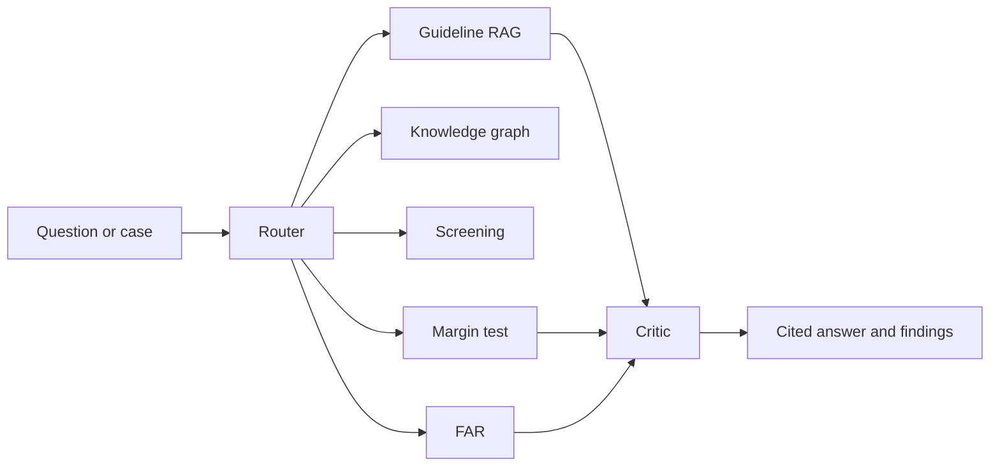

# Transfer Pricing Copilot — OECD-Regelwerks-RAG & Benchmarking

**Live public page:** [https://shyam-gupta-chiliveri.github.io/transfer-pricing-copilot/](https://shyam-gupta-chiliveri.github.io/transfer-pricing-copilot/)

That page is the public face of the bench. The interactive desk runs in Docker.

The bench walks one controlled group from the function to the file: characterization, method choice, comparable screening, the statutory range, the transaction matrix, and a critic that keeps a paragraph off the page unless it was retrieved. The worked example is the fictional hardening group Härtetechnik AG, so the numbers can be checked.

This is a portfolio project. It is not tax advice, not a client engagement, and not a claim of transfer-pricing work experience.

## The case

**Härtetechnik AG** is invented.

| Entity | Role | What it actually does |
|---|---|---|
| HTDE, Stuttgart | Principal | Owns the hardening recipes, PPAP approval, 8D responsibility and the OEM contracts |
| HTPL, Poland | Contract manufacturer | Induction-hardens and machines to HTDE's specification |
| HTUS, Detroit | Limited-risk distributor | Sells to US OEMs and does not own the process |

The ledger has 612 generated bookings for 2023–2025. In 2023 and 2024 the Polish net cost plus is 5.00%, inside the peer range. In 2025 the furnace energy cost jumps and the transfer price does not follow. Net cost plus falls to 2.00%.

That is the point of using a hardening plant. The economics are the same kind of factory facts as a PPAP or an 8D report: who owns the recipe, who carries the energy-price risk, who faces the customer.

## What the desk finds for 2025

- Polish net cost plus 2.00% is below the narrowed range (4.20%–6.80%, median 5.40%). Section 1(3a) AStG points to the median unless another in-range point is shown to be better.
- The US operating margin is about 10.2%, above a routine-distributor range of 2.10%–3.90%.
- A royalty is booked on top of the routine manufacturing return. That is a separate transaction under § 1(3c) AStG.
- The management charge has no contract name. The transaction matrix under § 90(3) AO requires one.
- The § 1(3b) AStG escape from a transfer-package valuation needs both exclusivity and an arm's length cost-plus return. Exclusivity is met. The 2025 return is not.

## Run it

Docker is the way to open the interactive desk:

```bash
docker compose up --build
```

Then open http://127.0.0.1:8510. Stop it with `docker compose down`. Port 8510 is used on the host so this desk does not take 8501 from another local app.

Without Docker:

```bash
python3 -m venv .venv
source .venv/bin/activate
pip install -r requirements.txt
pytest
streamlit run app.py
```

No API key. Answers are composed from the retrieved notes. The critic checks that every citation was actually retrieved.

The desk has an English / Deutsch switch at the top. On the Guidelines tab you can upload a PDF or text file for this browser session. A photo is not accepted: a scan without a text layer has no paragraph to cite.

```bash
python -m tp_copilot --eval
python -m tp_copilot --case
python -m tp_copilot "When should I use TNMM rather than the cost plus method for a contract manufacturer?"
```

## Result on the published question set

45 questions ship in `tp_copilot/eval/questions.py`. Top-3 citation accuracy on that set is **45/45** after the intent rules below. The questions are visible in the repository, so the score is not a hidden exam. It checks that the retriever opens the intended paragraph.

Company screening is TF-IDF plus logistic regression, the same accept/reject task as TruthLens, without a GPU model. Five-fold F1 on the portfolio labels is about **94%**. The table in the app shows out-of-fold predictions.

## Architecture



The collection is named `tp_regelwerke`. Retrieval is local TF-IDF with paragraph metadata. The materials project used Qdrant for ISO norms. The contract is the same: chunk, metadata, top-k, citation. A vector database is not required to run this desk.

Paragraph chunking for a file you add yourself is in `tp_copilot/ingest/chunker.py`. It splits on `1.33.` style numbers and on `§` sections.

## What is reused, and what is not

The agent pattern comes from the materials desk: a router, specialists, and a critic. The classification task comes from TruthLens. The margin arithmetic is ordinary P&L work.

The materials documents stay in that project. Nothing in this repository is an ISO norm, a SEM image, or a client ledger. Only the structure moved.

## Sources and what is deliberately absent

The running index is a set of original study notes in `tp_copilot/knowledge/notes.py`. Each note names the paragraph it is about. The notes are not the OECD Transfer Pricing Guidelines and not the BMF letter.

The OECD book is copyrighted and is not in this repo. German statute text on gesetze-im-internet.de is the official source for § 1 AStG. The Verwaltungsgrundsätze Verrechnungspreise are the BMF letter of 6 June 2023. The transaction-matrix columns follow the BMF leaflet of 2 April 2025 on § 90(3) AO.

To extend the index, put a PDF, TXT, XML or MD file in `data/regelwerke/` and restart. See `data/regelwerke/PLACE_OFFICIAL_FILES_HERE.txt`.

Peer companies and their margins are written for this case. They are not an Orbis or SEC extract. `scripts/fetch_edgar.py` shows how public company facts can be pulled later. It is not used by the app.

## Method choice, in one paragraph

TNMM with net cost plus is used for HTPL because gross mark-ups of hardening plants are hard to compare: energy, scrap and overhead are classified differently. That is the most-appropriate-method test in OECD TPG paragraph 2.2, read with paragraphs 2.45 and 2.64. Paragraph 2.3 prefers a traditional method only when it is equally reliable. A profit split is a poor fit because only HTDE makes a unique contribution (paragraph 2.119). CUP has no independent price for this process.

## CV line

> Transfer Pricing Copilot. Local RAG over original study notes on the OECD Transfer Pricing Guidelines 2022, § 1 of the German Foreign Tax Act, and the 2023 administrative principles, with paragraph citations (45/45 top-3 on a published question set). TF-IDF screening of company descriptions and an interquartile margin test on the fictional Härtetechnik case (TNMM, net cost plus). Synthetic bookings. A project, not a client engagement. Public page: https://shyam-gupta-chiliveri.github.io/transfer-pricing-copilot/

> Transfer Pricing Copilot – OECD-Regelwerks-RAG & Benchmarking. RAG über eigene Studiennotizen zu den OECD-Verrechnungspreisleitlinien 2022, § 1 AStG und den VWG VP 2023 mit Randnummern (45/45 Top-3 auf dem veröffentlichten Fragensatz). Screening von Unternehmensbeschreibungen (TF-IDF, logistische Regression) und Interquartilstest nach § 1 Abs. 3a AStG am Fall Härtetechnik AG (TNMM, Net Cost Plus). Synthetische Buchungen, kein Mandant.

Say it is a project. The people who read this file for a living will ask why TNMM and not cost plus. The answer is in the case file, not in a job title.

## Layout

```
app.py                          Streamlit desk
tp_copilot/agents/              router, RAG, graph, screening, margins, FAR, critic
tp_copilot/knowledge/notes.py   study notes with paragraph ids
tp_copilot/ingest/chunker.py    paragraph splitter for local files
tp_copilot/eval/questions.py    45 questions
data/group/                     generated ledger
data/comparables/               labeled descriptions
tests/test_copilot.py
```
